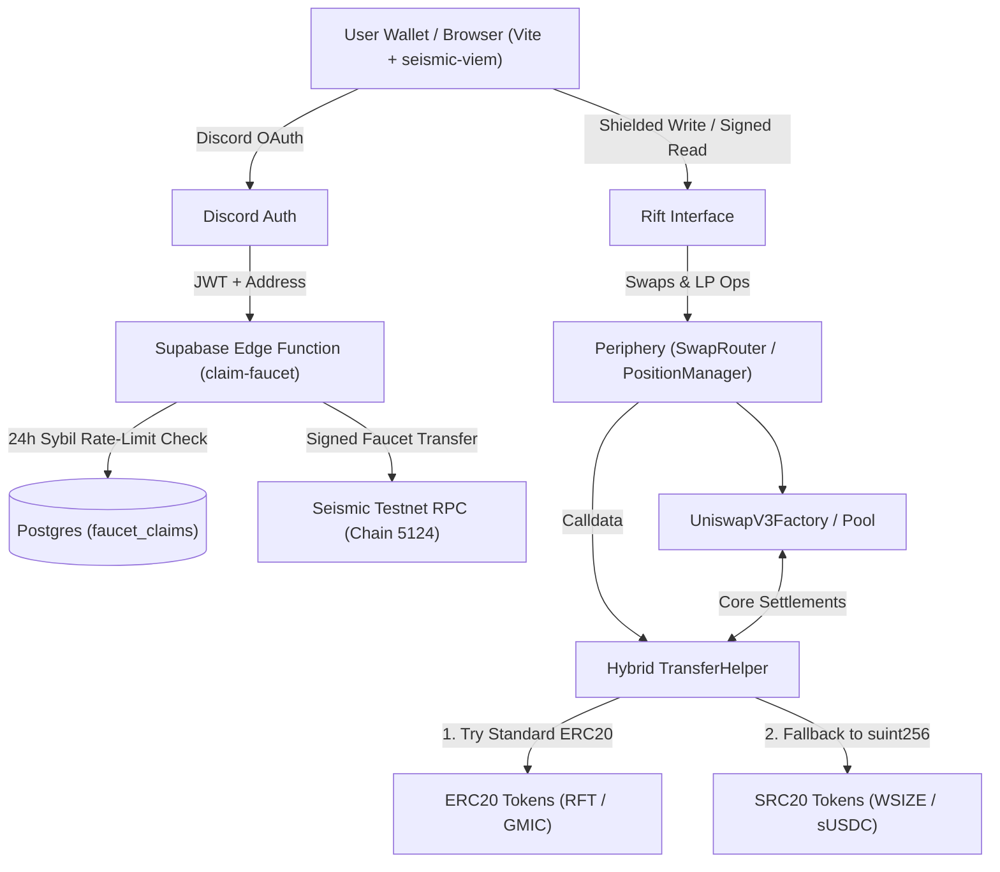

# Rift CLMM

**Hybrid ERC20 / SRC20 Concentrated Liquidity Market Maker (`v0.1 Beta`) on Seismic Testnet**

🌐 **Live dApp:** [https://riftprotocol.xyz](https://riftprotocol.xyz)  
🔍 **Explorer:** [https://seismic-testnet.socialscan.io/](https://seismic-testnet.socialscan.io/)  
🐦 **X / Twitter:** [@riftprotocolxyz](https://x.com/riftprotocolxyz) · [@OX_SHAH](https://x.com/OX_SHAH)

---

## Overview

Rift CLMM is a concentrated liquidity decentralized exchange deployed on **Seismic Testnet (Chain ID `5124`)**. While inspired by Uniswap v3's tick-based liquidity architecture, Rift extends both core/periphery smart contracts and the Vite + TypeScript + `seismic-viem` frontend to route **standard ERC20 tokens** alongside **Seismic Shielded ERC20 (`SRC20`) tokens** (`WSIZE`, `sUSDC`) within a unified liquidity layer.

> ⚠️ **v0.1 Beta Status & Log Transparency Notice**  
> Smart contracts are currently in unaudited testnet beta (`v0.1 Beta`). In this release, pool and token events (`Mint`, `Burn`, `Swap`, `Transfer`, `Approval`) intentionally remain **public standard Solidity logs** to facilitate deterministic indexing, AMM invariant verification, and UI/UX debugging during live testnet validation before transitioning to Seismic-native shielded/encrypted event logs.

---

## Architecture Highlights (Beyond a Standard Uniswap V3 Fork)

1. **Hybrid ERC20 / SRC20 Transfer & Approval Fallback (`contracts/src/core/libraries/TransferHelper.sol`, `contracts/src/periphery/libraries/TransferHelper.sol`)**  
   Standard Uniswap v3 contracts assume `transfer(address,uint256)` and `transferFrom(address,address,uint256)` signatures everywhere. In Seismic, `SRC20` tokens use shielded integer calldata types (`transfer(address,suint256)`, `transferFrom(address,address,suint256)`, `approve(address,suint256)`). Both Core and Periphery `TransferHelper` libraries attempt standard ERC20 calls first and seamlessly fall back to `SRC20` shielded selectors when interacting with wrapped/shielded assets.
2. **Shielded Native Wrapper (`WSIZE.sol` & `PeripheryPayments.sol`)**  
   `WSIZE` wraps native `SIZE` while storing balances (`mapping(address => suint256)`) and allowances in Seismic shielded storage with caller-restricted view checks (`balanceOf`, `allowance`). `PeripheryImmutableState`, `IWETH9`, `PeripheryPayments`, and `PeripheryPaymentsWithFee` are adapted to unwrap `WSIZE` via `withdraw(suint256)`.
3. **TEE/Seismic-Adapted Pool Lookup & Init Code Introspection**  
   - `UniswapV3PoolDeployer` exposes `poolBytecodeHash()` (`keccak256(type(UniswapV3Pool).creationCode)`) for exact pool verification.  
   - `PoolAddress.computeAddress` resolves canonical pool addresses directly via `factory.getPool(token0, token1, fee)` with deployment verification, preventing stale `CREATE2` hash mismatches during upgrades.
4. **Encrypted Calldata Execution & Signed Reads (`interface/` + `seismic-viem`)**  
   The frontend uses `seismic-viem` (`createShieldedWalletClient` & `createShieldedPublicClient`) for shielded writes (`sUSDC`, `WSIZE`) alongside Discord-gated faucet rate limiting backed by a Supabase Edge Function (`supabase/functions/claim-faucet`).


### Hybrid Routing & Faucet Architecture



---

## Monorepo Structure

| Path | Description |
| --- | --- |
| [`contracts/`](contracts) | Seismic Foundry (`sforge` / `ssolc 0.8.31`) smart contracts (`src/core`, `src/periphery`, `src/tokens`), deployment script (`script/`), unit tests (`test/`), and pinned git submodules (`lib/`) |
| [`interface/`](interface) | Vite + TypeScript + `seismic-viem` web interface (`https://riftprotocol.xyz`) |
| [`supabase/`](supabase) | Sanitized Supabase Edge Function (`claim-faucet`), Postgres migration schema, and runtime configuration |
| [`docs/`](docs) | Protocol architecture whitepaper (`clmm-whitepaper.md`) and Seismic Testnet deployment registry (`DEPLOYED_CONTRACTS.md`) |
| [`.github/workflows/`](.github/workflows) | Continuous integration workflow for frontend build and contract compilation/tests |

---

## Deployed Contracts (Seismic Testnet — Chain ID `5124`)

RPC Endpoint: `https://testnet-3.seismictest.net/rpc` · Explorer: [seismic-testnet.socialscan.io](https://seismic-testnet.socialscan.io/)

| Component | Address | Explorer Link |
| --- | --- | --- |
| `UniswapV3Factory` | `0x95151b5D611dcD241b58cc5D0C86eBFDC7d88e76` | [View Contract](https://seismic-testnet.socialscan.io/address/0x95151b5D611dcD241b58cc5D0C86eBFDC7d88e76) |
| `SwapRouter` | `0x15D499264016C01143eb84bce319f762cFe2AB19` | [View Contract](https://seismic-testnet.socialscan.io/address/0x15D499264016C01143eb84bce319f762cFe2AB19) |
| `NonfungiblePositionManager` (`RFT-POS`) | `0xCF1e20C1063B8037A3D281D85Af00a915cC84025` | [View Contract](https://seismic-testnet.socialscan.io/address/0xCF1e20C1063B8037A3D281D85Af00a915cC84025) |
| `NonfungibleTokenPositionDescriptor` | `0xAaD65F433bf040a7006972258797ED8806558aB5` | [View Contract](https://seismic-testnet.socialscan.io/address/0xAaD65F433bf040a7006972258797ED8806558aB5) |
| `NFTDescriptor` | `0x10Da485D8E21c8F9DB75EF76CFf5E16Ee5d938CE` | [View Contract](https://seismic-testnet.socialscan.io/address/0x10Da485D8E21c8F9DB75EF76CFf5E16Ee5d938CE) |
| `QuoterV2` | `0xe5320b750Fced30B9c1eC9b30C06B3996092E032` | [View Contract](https://seismic-testnet.socialscan.io/address/0xe5320b750Fced30B9c1eC9b30C06B3996092E032) |
| `WSIZE` (`SRC20`) | `0x2F3A25941AB75Ef97c97749343d7c71F09762e48` | [View Token](https://seismic-testnet.socialscan.io/address/0x2F3A25941AB75Ef97c97749343d7c71F09762e48) |
| `sUSDC` (`SRC20`) | `0x790701048922e265105fd6a4467a2901c2201c43` | [View Token](https://seismic-testnet.socialscan.io/address/0x790701048922e265105fd6a4467a2901c2201c43) |
| `RFT` (`ERC20`) | `0x63130c77500Cebf7f6B9f01545Fc4F3925dFe007` | [View Token](https://seismic-testnet.socialscan.io/address/0x63130c77500Cebf7f6B9f01545Fc4F3925dFe007) |
| `GMIC` (`ERC20`) | `0xc59fb7a8D9bf1c5863D000724c420F701B349A92` | [View Token](https://seismic-testnet.socialscan.io/address/0xc59fb7a8D9bf1c5863D000724c420F701B349A92) |

See [docs/DEPLOYED_CONTRACTS.md](docs/DEPLOYED_CONTRACTS.md) for active liquidity pool addresses and the pool init code hash.

---

## Local Setup & Testing

### 1. Clone with Submodules

```bash
git clone --recursive https://github.com/Shahrokh20000/rift-clmm.git
cd rift-clmm
```

If already cloned without `--recursive`:

```bash
git submodule update --init --recursive
```

### 2. Smart Contracts (`sforge` / `ssolc`)

Requires **Seismic Foundry** (`sforge` and `ssolc`) because `WSIZE.sol` and hybrid `TransferHelper` contracts compile shielded `suint256` types:

```bash
cd contracts
cp .env.example .env
sforge build
sforge test -vv
```

### 3. Frontend Interface (`Vite + TypeScript`)

```bash
cd interface
cp .env.example .env
# Fill in VITE_SUPABASE_URL and VITE_SUPABASE_ANON_KEY for Discord faucet authentication
npm ci
npm run dev
```

To build for production:

```bash
npm run build
```

### 4. Supabase Edge Function (`claim-faucet`)

```bash
cd supabase
cp .env.example .env
# Configure SUPABASE_URL, SUPABASE_ANON_KEY, SUPABASE_SERVICE_ROLE_KEY, FAUCET_PRIVATE_KEY
supabase db push
supabase functions deploy claim-faucet
```

---

## License

Released under the [MIT License](LICENSE).
